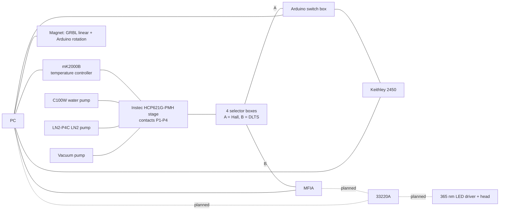
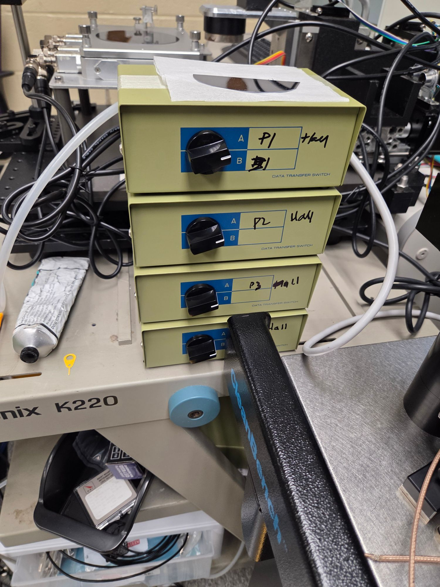
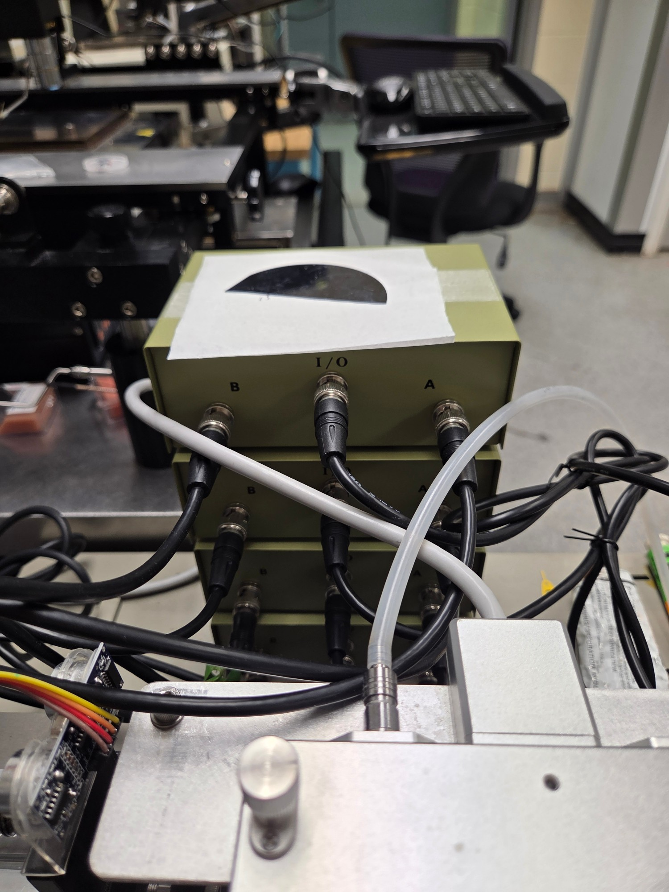
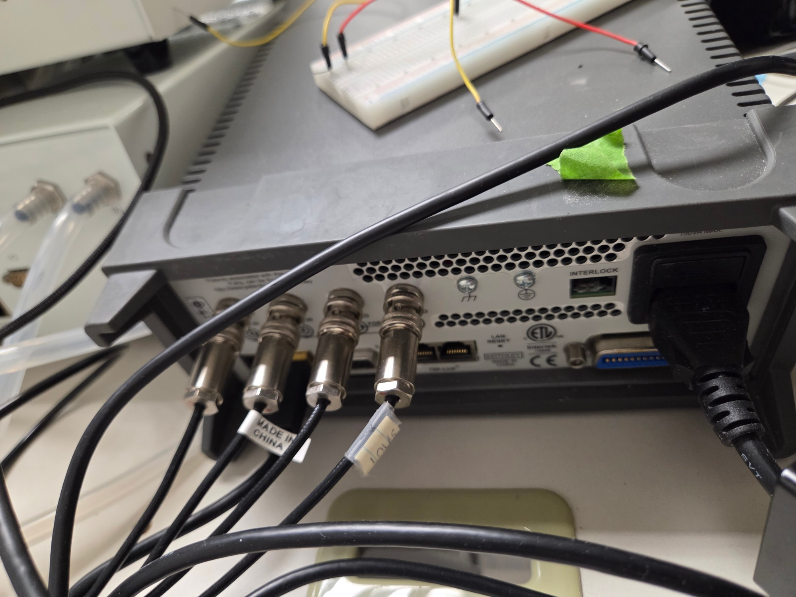
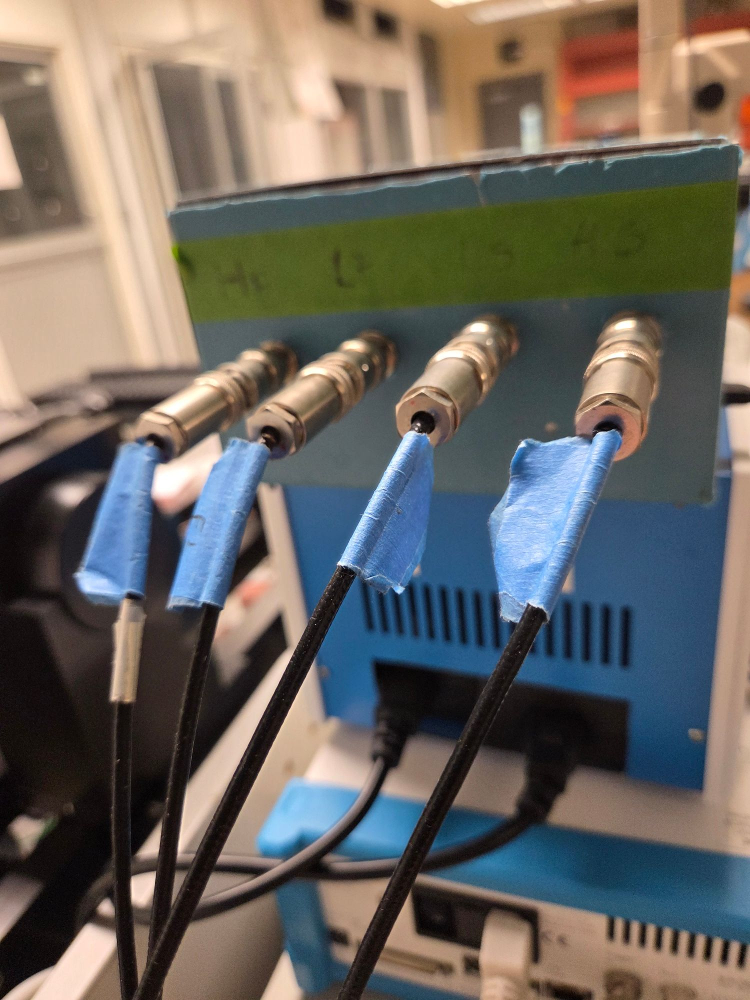
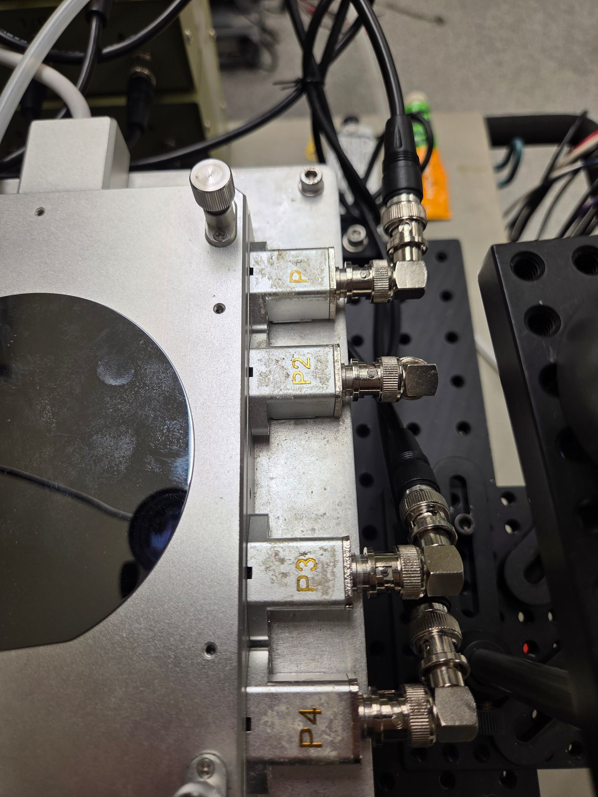
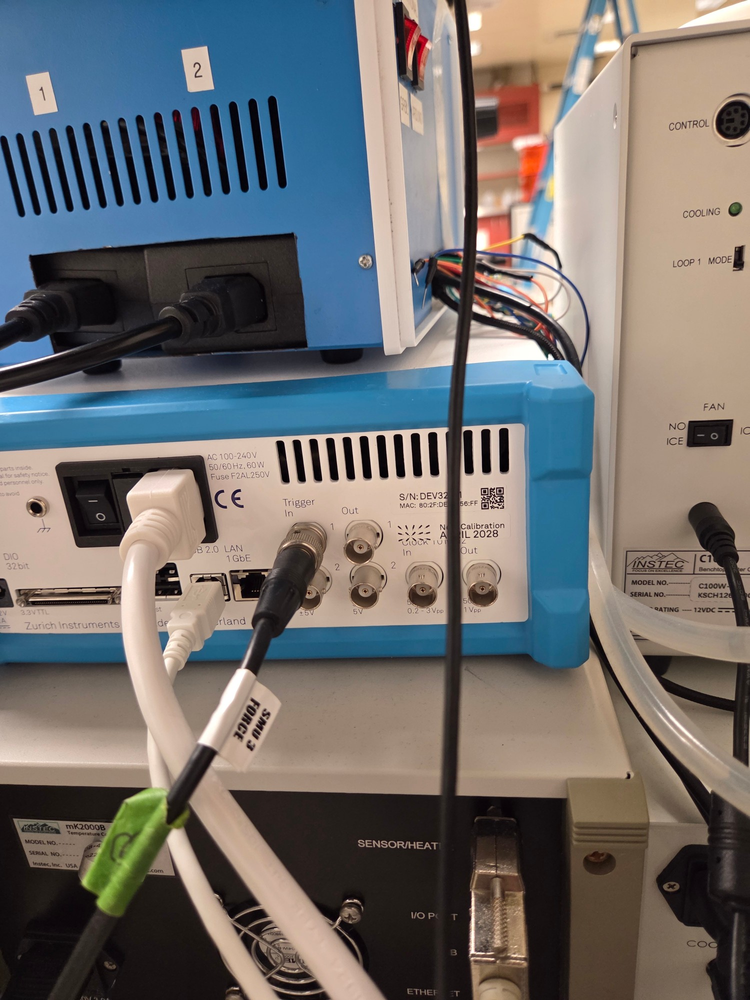
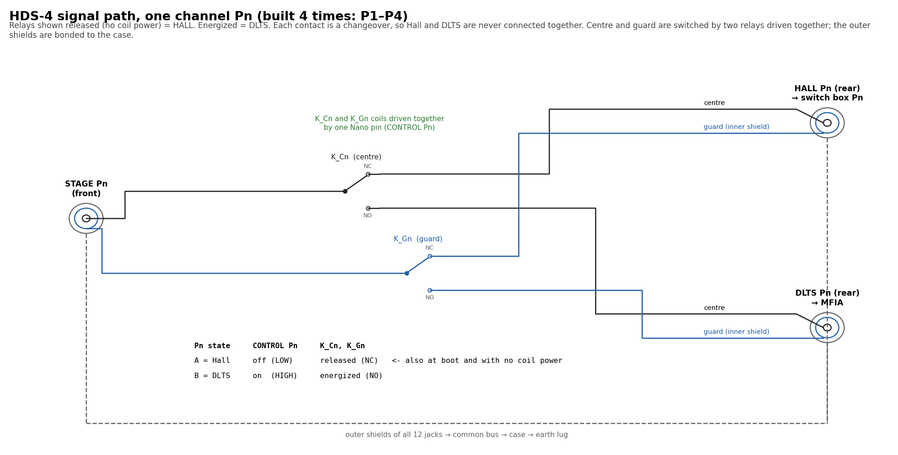
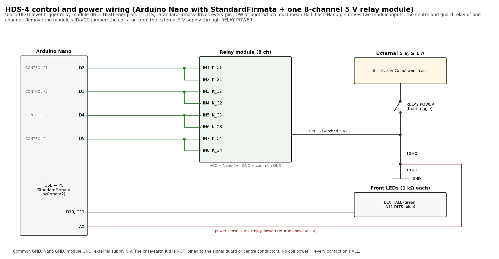

# Hall / DLTS Bench: Hardware Manual

Version 1.0, 2026-11-24. For **users** (running Hall or DLTS measurements) and **builders** (wiring, maintaining and extending the bench).

Every item in this manual has a status:

| Mark | Meaning |
|---|---|
| **Installed** | On the bench now, as shown in the photos. |
| **Planned** | Hardware exists and the software supports it, but it is not wired in yet (the 33220A and the 365 nm light source). |
| **Designed** | Design only, not built (the HDS-4 selector). |
| **TBD** | Information still to be filled in. |

Photos are in [photos/](photos/). The software is described in its own documents: the DLTS GUI in this repository (`docs/`), the Hall GUI in the `HallProbe_Software` repository.

---

## Part A: For users

### A1. What the bench does

One cryostat stage serves two measurement setups:
- **Hall / resistivity**: a Keithley 2450 SourceMeter, routed to the four sample contacts by an Arduino relay box. Run by the Hall software.
- **DLTS** (deep-level transient spectroscopy): a Zurich Instruments MFIA impedance analyzer measures capacitance transients after bias pulses. Run by the DLTS software. **Planned:** O-DLTS/MCTS, where a 365 nm LED pulse fills the traps.

Everything else is shared:
- the Instec stage and its temperature controller;
- the cooling (water pump, LN2 pump, vacuum);
- the sample and its four contacts P1–P4;
- the magnet (used by Hall).

Four manual selector boxes choose, for each contact, which instrument is connected.

### A2. Safety

Your own sample sets most limits (bias, current, temperature range, ramp rate). Write them in your run plan, inside the device limits of §A8.

- **UV light (planned light source).** The 365 nm head is invisible and harmful to eyes and skin.
  - Run it only clamped in the lid adapter.
  - Wear OD ≥ 4 glasses at 365 nm whenever it is armed and out of the adapter.
  - Turn the driver's **arming switch** off before touching the head or the sample. The red UV ON lamp means the LED can fire.
- **Cryogen.** Wear cryogenic gloves and a face shield when handling LN2. Make sure the room is ventilated.
- **Heat.** The stage reaches 850 K. Let it return to room temperature before opening it. Both programs ramp it back at the end of a run and when they close.
- **Electrical.**
  - The Keithley 2450 can source up to 200 V (panel marking 210 V peak).
  - Change selector knobs and cables only with the instrument outputs off.
- **Moving parts and magnet.**
  - The magnet's linear stage and rotator move under software control; keep hands clear while the Hall software is open, because it homes the magnet at start-up.
  - Keep magnetic tools and media away from the magnet. People with implanted medical devices should keep their distance.

### A3. The equipment

| Item | Model | Role | Status | Photo |
|---|---|---|---|---|
| Cryostat / Hall probe stage | Instec HCP621G-PMH | Holds the sample. Optical window on top. BNC feedthroughs P1–P4. 77–850 K | Installed | [Stage](photos/Instec_Stage.jpg) |
| Temperature controller | Instec mK2000B | Ramps and holds the stage temperature. Serial link to the PC (COM7) | Installed | MFIA_Back (bottom of photo) |
| Water pump / chiller | Instec C100W | Cooling water | Installed | MFIA_Back (right of photo) |
| LN2 pump | Instec LN2-P4C | Pumps LN2 for cooling below room temperature | Installed | [Instec units](photos/Instec_Pump_Units.jpg) |
| Vacuum pump | Oil-free electric (model TBD) | Stage vacuum | Installed | – |
| Impedance analyzer | Zurich Instruments MFIA, S/N DEV32271 | DLTS: capacitance and bias pulse | Installed | [MFIA front](photos/MFIA_Front.jpg) |
| SourceMeter | Keithley 2450 | Hall / resistivity I–V; uses the rear terminals | Installed | [Keithley](photos/Sourcemeter_Front.jpg) |
| Hall switch box | Arduino relay box (blue) | Routes the Keithley's four terminals to P1–P4 in 20 configurations | Installed | [Switch box](photos/SwitchBox_Front.jpg) |
| Hall/DLTS selector | 4 × manual A/B "Data Transfer Switch" | Per contact: A = Hall, B = DLTS | Installed | [Selectors](photos/Hall_DLTS_Switches.jpg) |
| Magnet positioner | Linear stage (GRBL) + rotation stage (Arduino) in the magnet control box | Moves the magnet in and out and flips its polarity for Hall | Installed | [Magnet stage](photos/Magnet_LinearStage_1.jpg) |
| USB hub | 7-port, powered | Connects the instruments to the PC | Installed | [USB hub](photos/USB_Hub.jpg) |
| Waveform generator | Agilent 33220A | Drives the LED driver; triggered by the MFIA | Planned | – |
| 365 nm light source | LED head on the cryostat lid + current-sink driver | Optical fill for O-DLTS/MCTS | Planned | – |
| HDS-4 selector | Relay box | Replaces the four A/B boxes under software control | Designed | – |

### A4. Choosing Hall or DLTS

The four selector boxes, stacked P1 (top) to P4 (bottom), connect each stage contact to the Hall path (**A**) or the DLTS path (**B**).

To change setups:
1. Stop or finish the run in the current program. Make sure the Keithley output is off (the Hall software turns it off after each point) and no DLTS acquisition is running.
2. Turn **all four** knobs to the same letter: **A for Hall, B for DLTS**.
3. For DLTS, check that the program you are about to use is set up as in §A5 or §A6.

Leaving the knobs mixed (some A, some B) connects the sample to both instruments at once. Neither measurement is then valid.

### A5. Hall measurement: hardware checklist

1. Selector knobs on **A**.
2. Keithley 2450 on. Its rear terminals are cabled, so leave the front TERMINALS switch on REAR (the software selects rear).
3. Magnet control box: **LINEAR (GRBL)** and **ROTATIONAL (ARDUINO)** switches on. The Hall software homes the magnet when it starts.
4. Temperature controller and cooling as your run plan requires.
5. Run the Hall software (`HallProbe_Software`). The procedure is the software's.

### A6. DLTS measurement: hardware checklist

1. Selector knobs on **B**.
2. MFIA on. Check the front-panel loop: **Aux Output 1 → Aux Input 1** must stay connected. It carries the bias pulse; without it there are no transients.
3. **Sample wiring is 2-terminal**: the sample sits between P1 (MFIA HCUR) and P2 (MFIA LCUR). On the DLTS Input Parameters tab, set **Equivalent Circuit Mode = 1 - 2-Terminal** for every run. The software's default is 4-Terminal, but HPOT is not wired on this bench.
4. Temperature controller on. In the DLTS software, choose the controller's port in the **Serial Port** box (COM7) and click **Connect + Get Params**. If it says the port is busy, close the Hall software or disconnect the controller there: only one program can hold COM7.
5. The procedure is the DLTS software's: see `docs/running_a_dlts_experiment.md`.

### A7. O-DLTS / MCTS with the light source (planned)

When the light source is installed (wiring in §B3, cables 21–26):

1. Do everything in §A6.
2. LED head clamped in the lid adapter over the window. Set the zoom ring from COLLIMATED as the light source user manual describes, and lock it.
3. LED driver supply on, **arming switch off**. 33220A on and connected to the PC.
4. In the DLTS software's Light Source panel:
   - pick the 33220A;
   - choose the excitation method;
   - set the LED current, pulse width and delay;
   - click **Connect + Get Params**, then **Apply + Push Params**. Settings that would overdrive the LED are refused.
5. Arming switch **on** (the UV ON lamp lights). Start the run. The software switches the LED output on only while data is taken, and off on pause, error, abort or exit.
6. Afterwards: arming switch **off**. The red **LED OFF** button in the software switches the 33220A output off at any time.

Light source user manual (zoom settings, irradiance table, troubleshooting): `BuiltLightSourceFor_O-DLTS_MCTS/docs/UserManual.md`. Software details: `docs/optical_dlts_light_source.md`.

### A8. Device limits

These are the instruments' limits. A sample's safe limits are usually tighter.

| Device | Limit |
|---|---|
| Instec HCP621G-PMH stage | 77–850 K |
| Keithley 2450 | Ranges 20 mV–200 V and 10 nA–1 A. 20 W, four-quadrant. Panel markings: 210 V peak HI–LO, 5 V peak sense–force, 250 V peak LO–chassis. |
| MFIA Signal Output | ±10 mV, ±100 mV, ±1 V, ±10 V ranges; 100 mA maximum drive |
| MFIA Signal Input | 3 V peak (panel marking). Current ranges from 1 nA to 10 mA. |
| MFIA Aux In / Aux Out | ±10 V. Aux In 1 can be added to the signal output (DC–2 MHz). |
| Agilent 33220A (planned) | Up to 10 Vpp into 50 Ω. The software sets output voltage limits that protect the LED driver. |
| LED driver (planned) | CTRL IN 0–4 V (49.9 Ω) gives 0–1 A (JP1 on 1 Ω) or 0–100 mA (JP1 on 10 Ω). 1 A continuous for seconds only. Software caps: 0.3 A average, 0.2 A steady. |
| HDS-4 (designed) | Switch only with the instrument outputs off. |

Sources:
- [Tektronix 2450 specifications](https://www.tek.com/en/documents/specification/model-2450-interactive-sourcemeter-instrument-specifications)
- [MFIA specifications](https://docs.zhinst.com/mfia_user_manual/specifications.html)
- light source build guide.

### A9. Troubleshooting (hardware side)

| Symptom | Likely cause | Check |
|---|---|---|
| DLTS: "Temperature controller: NOT connected … could not open COM7" | Another program (usually the Hall software) holds the port, or the wrong port is chosen | Close or disconnect the other program; check the Serial Port box |
| DLTS: flat or missing transients | Aux Out 1 → Aux In 1 loop unplugged; knobs on A; 4-terminal mode selected | §A6 steps 1–3 |
| DLTS: capacitance offset after recabling | Stray capacitance of the new cables | Redo the MFIA open/short compensation |
| Hall: open circuit or nonsense resistances | Knobs on B, or mixed | §A4 |
| Hall: the magnet does not move | Magnet box switches off; wrong COM port | §A5 step 3; the Hall software's port settings |
| O-DLTS: no signal, flat I_MON | Arming switch off, driver supply off, cable 21 or 22 missing | §B3 |
| O-DLTS: capacitance steps exactly at the LED edges, even at tiny current | Electrical pickup from the LED leads | Reroute the LED twisted pair away from the MFIA cables; check grounding |

---

## Part B: For builders

### B1. Signal paths

**Selector boxes** (installed). Each box has three BNCs on the back: **A**, **I/O**, **B**. I/O is the common.

| Selector | I/O | A (Hall) | B (DLTS) |
|---|---|---|---|
| P1 (top) | Stage P1 | Switch box P1 | MFIA Signal Output **HCUR** |
| P2 | Stage P2 | Switch box P2 | MFIA Signal Input **LCUR** |
| P3 | Stage P3 | Switch box P3 | MFIA Signal Input **LPOT** (unused in 2-terminal mode) |
| P4 (bottom) | Stage P4 | Switch box P4 | free |

Whether these boxes also switch the shields, or keep the A and B shields common, is **TBD**. Check with an ohmmeter. It matters for the HDS-4 shield option (§B6).

**Hall path.** Keithley 2450 rear terminals → Arduino switch box rear → switch box front P1–P4 → selectors (A).

| Connector | Ports, left to right as seen from the back |
|---|---|
| Keithley rear | Sense HI, Force HI, Sense LO, Force LO |
| Switch box rear | Force HI (Hf), Force LO (Lf), Sense LO (Ls), Sense HI (Hs) |
| Switch box front | P4, P3, P2, P1 |

  

The switch box is an Arduino running StandardFirmata (COM6). Twelve digital pins (D2–D13) set the relays: three pins per Keithley terminal choose its contact. Configurations 1–8 are resistivity and 9–20 are Hall. The switch box has no "all open" state. Its firmware is not in either repository (**TBD**). Configuration details: `HallProbe_Software/docs/reference/switchBox.md`.

**DLTS path and bias generation.** The MFIA makes the DLTS bias pulse itself:
- **Threshold unit.** It alternates between fill and reverse-bias states (State Enable Time = reverse bias, State Disable Time = fill).
- **Aux Output 1.** It outputs *Offset* during fill and *Offset + Scale* during reverse bias.
- **Bias loop.** A short BNC loop takes Aux Output 1 to **Aux Input 1**. The MFIA adds Aux Input 1 onto Signal Output HCUR (`sigouts/0/add`).
- **Recording.** Aux Input 1 is recorded as `AuxInput1`. The analysis finds every transient from its falling edge.
- **Triggering.** The DAQ triggers internally on Trigger Out 1 (= Threshold 1), so no trigger cable is needed.

### B2. MFIA port allocation

| Port | Use | Status |
|---|---|---|
| Signal Output HCUR | Sample P1 (via selector B) | Installed |
| Signal Output (second BNC) | – | Free |
| Signal Input LCUR | Sample P2 (via selector B) | Installed |
| Signal Input LPOT | Selector P3 B (unused in 2-terminal mode) | Installed |
| Signal Input HPOT | – | Free (needed for a future 4-terminal setup) |
| Aux Output 1 → Aux Input 1 | Bias loop | Installed |
| Aux Input 2 | LED driver I_MON | Planned |
| Aux Output 2, 3, 4 | – | Free |
| Trigger Out 1 | Used internally (DAQ trigger) | No cable |
| Trigger Out 2 | 33220A Trig In | Planned |
| Trigger In 1 | Cable plugged in ("SMU 3 FORCE"), far end loose | Not used |
| Trigger In 2, Clock In/Out, DIO | – | Free |
| USB, LAN | PC / network | Installed |

### B3. Complete cable table

| # | From | To | Status |
|---|---|---|---|
| 1 | Keithley rear Sense HI | Switch box rear Hs | Installed |
| 2 | Keithley rear Force HI | Switch box rear Hf | Installed |
| 3 | Keithley rear Sense LO | Switch box rear Ls | Installed |
| 4 | Keithley rear Force LO | Switch box rear Lf | Installed |
| 5–8 | Switch box front P1–P4 | Selector P1–P4, A | Installed |
| 9–12 | Selector P1–P4, I/O | Stage P1–P4 | Installed |
| 13 | Selector P1, B | MFIA HCUR | Installed |
| 14 | Selector P2, B | MFIA LCUR | Installed |
| 15 | Selector P3, B | MFIA LPOT | Installed |
| 16 | Selector P4, B | – | Free |
| 17 | MFIA Aux Output 1 | MFIA Aux Input 1 | Installed |
| 18 | MFIA Trigger In 1 | loose cable | Not used |
| 19 | MFIA USB / LAN | PC / network | Installed |
| 20 | mK2000B rear I/O PORT | PC (COM7) | Installed |
| 21 | MFIA rear Trigger Out 2 | 33220A rear Trig In (Ext Trig) | Planned |
| 22 | 33220A front Output | LED driver CTRL IN (J1, SMA) | Planned |
| 23 | LED driver I_MON (J2, SMA) | MFIA front Aux Input 2 | Planned |
| 24 | LED driver LED output | LED head (twisted pair) | Planned |
| 25 | 9 V adapter | LED driver J3 | Planned |
| 26 | 33220A USB or LAN | PC | Planned |

Notes on the light source cables:
- **Cable 21:** the DLTS software sets Trigger Out 2 to Threshold 1, so the LED fires once per MFIA cycle, delayed by the LED Pulse Delay.
- **Cable 22:** the software sets the 33220A to `OUTP:LOAD 50` to match the driver's 49.9 Ω input. Keep the low level at 0 V.
- **Cable 23:** the MFIA aux input is 1 MΩ, so I_MON reads 1 V/A (1 A range) or 10 V/A (100 mA range).
- **Cable 24:** run the twisted pair all the way to the head, away from the HCUR/LCUR cables.

### B4. Computer interfaces (TBD: hub port map)

| Hub / PC port | Device | Windows port / address | Used by |
|---|---|---|---|
| TBD | Keithley 2450 (USB) | VISA `USB0::0x05E6::0x2450::04375166::INSTR` | Hall |
| TBD | Switch box Arduino | COM6 | Hall |
| TBD | Magnet GRBL | COM4 | Hall |
| TBD | Magnet rotation Arduino | COM3 | Hall |
| TBD | mK2000B (I/O port; adapter TBD) | COM7 | Hall and DLTS (one at a time) |
| TBD | MFIA (USB or LAN) | LabOne data server | DLTS |
| TBD | Agilent 33220A | VISA | DLTS (planned) |
| TBD | HDS-4 selector | COM TBD | both (designed) |

Windows serial ports are exclusive: only one program can hold COM7 (or COM6, COM4, COM3) at a time. The MFIA can be shared through LabOne.

### B5. Cooling and vacuum (TBD: tubing map)

| Stage fitting (front edge, left to right) | Connects to | Medium |
|---|---|---|
| 1 | TBD | TBD |
| 2 | TBD | TBD |
| 3 | TBD | TBD |
| 4 | TBD | TBD |
| 5 | TBD | TBD |

C100W rear panel: CONTROL (mini-DIN, from the controller), COOLING LED, LOOP 1 MODE switch, FAN NO ICE / ICE switch.

### B6. Planned and designed upgrades

**Light source (planned).** Commissioning steps:
1. Bench-test the driver into a 3 Ω, ≥ 5 W dummy load. Send 1 µs, 100 µs and 10 ms pulses. Check for clean I_MON edges and zero current at 0 V input and with the arming switch off.
2. Fit cables 21–26.
3. Check that the 33220A idles at 0 V between triggered bursts.
4. Run one room-temperature step and compare I_MON with the commanded marker. This sets the Commanded Timing Offset.
5. Set **LED Driver Range** in the software to match JP1.

Details: `docs/optical_dlts_light_source.md` and the light source build guide.

**HDS-4 Hall/DLTS selector (designed).** One box replaces the four A/B boxes and does the same job. It is built like the existing Hall switch box, from one 8-channel Arduino relay module, and has triax jacks.
- **Relays:** each contact has a pair of changeover relays (centre and guard) driven together: released = Hall (NC), energized = DLTS (NO). The outer shields are bonded to the case.
- **Controller:** its own Arduino Nano running the stock **StandardFirmata** sketch, driven from Python through pyfirmata2. This is the same arrangement and code structure as the Hall switch box (`switchBox.py`). Each contact switches independently.
- **Relay module:** must be the HIGH-level-trigger type (or have its H/L jumper on H). StandardFirmata sets every pin LOW at boot, and LOW must mean Hall.
- **Safety:**
  - Hall and DLTS can never be connected at once: each relay is a changeover contact and breaks before it makes.
  - Power-up, reset and the RELAY POWER switch all put every contact on Hall, the same as today's knobs on A.
- **Software:** Python driver `hallDltsSelector_Control.py`, so either program can check and set the routing. An unattended combined Hall + DLTS sequence needs this.
- **Cabling:** STAGE P1–P4 to the stage, HALL P1–P4 to the switch box, DLTS P1/P2/P3 to HCUR/LCUR/LPOT through triax-to-BNC adapters.
- **After installing:** redo the MFIA open/short compensation.

Build details, pin table, firmware protocol, BOM and test steps: `hardware/hallDltsSelector/README.md`.

### B7. Adding new hardware

The DLTS software is built to take more electrically and optically driven methods (the excitation-method table in `excitationTools.py`). When you add hardware:
1. **Ports:** use the free ports of §B2 and §B4.
2. **This manual:** add a row to §A3 and to the cable table §B3, with a status mark. Update §B2/§B4 and the limits in §A8.
3. **Drivers:** put a new instrument driver in its own `<maker><Model>_Control.py` file, a class that imports no app config, so the Hall software can share it later. See `AGENTS.md`.
4. **Photos:** take front and back photos with the cables in, and add them to `photos/`.

### B8. Maintenance

- **MFIA:** calibration due **April 2028** (rear sticker). Redo the open/short compensation after any cable change on the DLTS path.
- **Selector boxes:** check that the knobs are fully detented and that I/O reaches A and B as expected (continuity check) if a measurement looks wrong.
- **Ultrasonic sensors:** the two on the magnet stage are wired to the magnet-box Arduino and not used by the software. Leave them as they are.
- **Firmware TBD:** the switch box firmware (StandardFirmata?) and the magnet-box Arduino sketch should be archived in the Hall repository.

---

## Appendix: photo index

| Photo | Shows |
|---|---|
| [Hall_DLTS_Switches](photos/Hall_DLTS_Switches.jpg) | Selector boxes P1–P4, front (knob A = Hall, B = DLTS) |
| [P1Switch_Back](photos/P1Switch_Back.jpg) | Selector backs: B, I/O, A |
| [Instec_Stage](photos/Instec_Stage.jpg), [Instec_Stage_Ports](photos/Instec_Stage_Ports.jpg) | Stage, window, feedthroughs P1–P4, tube fittings |
| [Instec_Pump_Units](photos/Instec_Pump_Units.jpg) | Instec pump units |
| [MFIA_Front](photos/MFIA_Front.jpg), [MFIA_Back](photos/MFIA_Back.jpg) | MFIA ports. MFIA_Back also shows the mK2000B and the C100W rear panels. |
| [Sourcemeter_Front](photos/Sourcemeter_Front.jpg), [Sourcemeter_Back](photos/Sourcemeter_Back.jpg) | Keithley 2450 |
| [SwitchBox_Front](photos/SwitchBox_Front.jpg), [SwitchBox_Back](photos/SwitchBox_Back.jpg) | Arduino switch box |
| [Magnet_LinearStage_1](photos/Magnet_LinearStage_1.jpg), [Magnet_LinearStage_2](photos/Magnet_LinearStage_2.jpg), [Magnet_ControlBox](photos/Magnet_ControlBox.jpg) | Magnet positioner and its control box |
| [USB_Hub](photos/USB_Hub.jpg) | USB hub on the Keithley |

The working notes this manual was written from are in [connections_draft.md](connections_draft.md).
