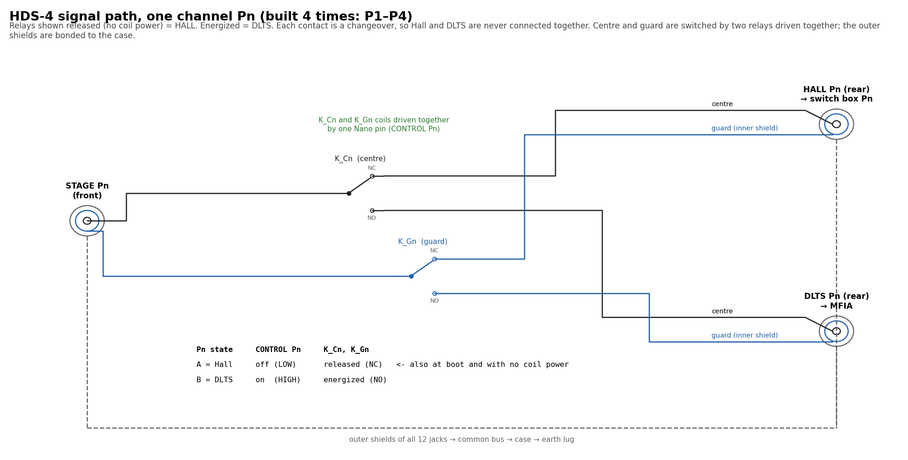
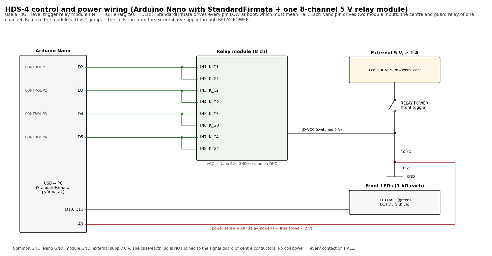

# HDS-4: Hall/DLTS selector (replacement for the four manual A/B boxes)

Status: **design only, not built**. Revision 3 (2026-11-24): **SELECT-only, StandardFirmata.**
- **Hardware:** one 8-channel Arduino relay module and triax jacks.
- **Software:** the Arduino runs the stock StandardFirmata sketch; all the logic is in Python through pyfirmata2.

This is the same build and the same code structure as the existing Hall switch box (`HallProbe_Software/switchBox.py`), so the two can be traced the same way. The driver is tested against a fake board (`tests/test_hall_dlts_selector.py`); nothing has run on hardware.

Earlier revisions are in the git history:
- **Rev 1:** reed relays with custom firmware.
- **Rev 2:** an extra CONNECT stage for an OPEN state.

The owner simplified both away: the merge is complex enough.

## 1. Why

The Hall and DLTS setups share the whole bench except the measuring instrument:
- **Hall:** the Keithley 2450, through the Arduino switch box.
- **DLTS:** the MFIA.

Today four manual "Data Transfer Switch" boxes pick the instrument for each stage contact (knob A = Hall, B = DLTS). See `docs/hardware_manual/HardwareManual.md` §A4 and §B1.

HDS-4 does the same job, the same way (a changeover per contact), but under software control:
- **The software can check the routing before a run.** A DLTS run can refuse to start while the sample is routed to the Keithley.
- **A combined Hall + DLTS sequence can run unattended.** This is stage 3 of `docs/planning/hall_dlts_merge_feasibility.md`.

## 2. Circuit

### Signal path (one channel; built four times, P1–P4)



All 12 jacks are **triax**, like the cables of the existing switch box. Each contact uses two changeover relays of the module, driven together by one Arduino pin:

| Relay | Common | NC (released) | NO (energized) |
|---|---|---|---|
| K_Cn (centre) | STAGE Pn centre | HALL Pn centre | DLTS Pn centre |
| K_Gn (guard) | STAGE Pn guard (inner shield) | HALL Pn guard | DLTS Pn guard |

| Contact state | Arduino pin | Relays |
|---|---|---|
| **A = Hall** (also at boot and with no relay power) | LOW | released (NC) |
| **B = DLTS** | HIGH | energized (NO) |

- **Hall and DLTS are never connected together**, because each relay is a changeover contact, which breaks before it makes.
- **Shields:**
  - The **outer shields** of all 12 jacks are bonded together and to the case, and the case is earthed through a lug.
  - The **guard (inner shield)** is switched with the centre.
- **DLTS jacks.** The MFIA has BNC connectors, so the DLTS jacks need triax-to-BNC adapters. **TBD:** confirm which triax conductor your existing adapters connect to the BNC shield, and keep the same convention on the stage-side cables.

### Control and power



- **Arduino Nano running StandardFirmata.** Flash it once: Arduino IDE → File → Examples → Firmata → StandardFirmata. It has its own USB serial port, separate from the Hall switch box's Arduino.
- **Relay module: one 8-channel 5 V module with HIGH-level trigger.** Many modules have an H/L jumper; set it to **H**.
  - **Why HIGH-level trigger:** StandardFirmata sets every pin to output LOW when it boots. With a HIGH-trigger module, LOW means released, which means Hall. A LOW-trigger module would put every contact on DLTS at each boot.
  - Check the module's input pull-down too, so the relays stay released while the Nano is still in its bootloader.

| Nano pin | Module inputs | Line |
|---|---|---|
| D2 | IN1 + IN2 (K_C1, K_G1) | P1 |
| D3 | IN3 + IN4 (K_C2, K_G2) | P2 |
| D4 | IN5 + IN6 (K_C3, K_G3) | P3 |
| D5 | IN7 + IN8 (K_C4, K_G4) | P4 |
| D10, D11 | LEDs HALL (green), DLTS (blue), through 1 kΩ each | written by the driver |
| A0 | switched coil supply through a 10 kΩ / 10 kΩ divider | `relay_power()` |

- **Power:**
  - Module logic (VCC) comes from the Nano's 5 V.
  - The coils (JD-VCC; **remove the module's JD-VCC jumper**) come from an external 5 V supply of at least 1 A, through the front **RELAY POWER** toggle. Eight coils at about 70 mA each is about 0.56 A in the worst case.
- **RELAY POWER off releases every relay**, so every contact is on Hall whatever the software wrote. The driver reads A0 and reports this before confirming DLTS.
- **Ground:** Nano, module and the external supply share 0 V. The case/earth lug is **not** joined to any signal guard or centre conductor.

Redraw the diagrams with `python selector_schematic.py` (needs matplotlib).

## 3. Leakage and capacitance

Arduino relay modules are not low-leakage parts. The existing Hall switch box uses them and works for the Hall measurements, so HDS-4 matches its performance. Steps to keep it there:
- **Physical separation.** Mount the module off the case on standoffs. Keep the signal wiring away from the coil/LED side of the board. Use short triax runs to the relay screw terminals.
- **DLTS compensation.** Redo the MFIA open/short compensation with HDS-4 in the path.
- **Upgrade path.** If leakage ever limits the highest-resistance Hall samples, swap the module for low-leakage relays wired the same way. Nothing in the software changes.

## 4. Python driver

`hallDltsSelector_Control.py` (repo root). Reference: `docs/reference/hallDltsSelector_Control.md`. It is laid out like `switchBox.py`:

| switchBox.py (Hall) | hallDltsSelector_Control.py (HDS-4) |
|---|---|
| `class SwitchBox` + singleton `switch_box` + module wrappers | `class HallDltsSelector` + singleton `selector` + module wrappers |
| `configurations(config)`: config 1–20 → contact of each Keithley terminal | `configurations(mode)`: `'hall'` / `'dlts'` → position of each contact |
| `set_pins(P)` → `(pinsDict, pinMap)` | `set_pins(P)` → `(pinsDict, pinMap)` |
| `set_state(pinsDict)`: `arduino.digital[pin].write(level)` | `set_state(pinsDict, pinMap)`: the same, plus the two LEDs |
| `connect_arduino()` / `disconn_arduino()` with `pyfirmata2.Arduino(port)` | `connect_arduino(port)` / `disconn_arduino(to_hall=False)`, the same calls |
| board in `hpc.switchBox`, flag `hpc.switchBoxOnOff` | board in `selector.board`, flag `selector.connected` (no app config imported, so both programs can use it) |

Added for HDS-4:
- `set_mode(mode)`, `set_channel(contact, position)`, `get_state()`, `get_mode()`, `routing_table()`.
- `relay_power()`: from the A0 callback; `None` until the first sample.
- `require_mode(mode)`: for a run's setup check.

Firmata cannot read the outputs back, so the driver reports the positions it last wrote. That is the same trust the Hall software places in its switch box.

```python
import hallDltsSelector_Control as hdsC
hdsC.connect_arduino('COM8')      # all contacts written to Hall
hdsC.set_mode('dlts')             # all contacts to the MFIA
hdsC.get_state()                  # {'P1': 'B', 'P2': 'B', 'P3': 'B', 'P4': 'B'}
hdsC.require_mode('dlts')         # None if routed to DLTS (and relay power not off), else the reason
print(hdsC.routing_table())
hdsC.disconn_arduino()            # routing left as it is; to_hall=True switches to Hall first
```

Not yet wired into either GUI. Planned:
- a selector panel on the DLTS Input Parameters tab and the Hall Hardware Test tab;
- `check_setup` refusing a run when the mode is wrong;
- the combined sequencer switching between Hall and DLTS.

**Switch dry.** Change the routing only with the instrument outputs off: the Keithley output and the MFIA signal output.

## 5. Build and test

1. **Flash StandardFirmata** to the Nano and set the relay module's trigger jumper to H.
2. **Before boxing**, test with an ohmmeter and the external 5 V on. Drive it from Python (`hdsC.connect_arduino(port)` and so on):

   | Action | Expected |
   |---|---|
   | Power-up / `connect_arduino` | No relay clicks. STAGE Pn → HALL Pn below 1 Ω (centre and guard). STAGE Pn → DLTS Pn open. HALL LED on. |
   | `set_mode('dlts')` | The reverse. DLTS LED on. |
   | `set_channel(2, 'A')` | Only P2 returns to Hall. |
   | RELAY POWER off in DLTS mode | Every contact back on HALL. `relay_power()` becomes `False`. |

3. **Leakage.** In DLTS mode with the HALL jacks open, measure from each HALL jack to the case and to the other channels with the Keithley on a low current range. Compare with the old switch box.
4. **Swap-in.** Cable HDS-4 in place of the four A/B boxes:
   - STAGE Pn ← stage feedthrough Pn;
   - HALL Pn → Arduino switch box Pn;
   - DLTS P1 → MFIA HCUR, P2 → LCUR, P3 → LPOT, P4 free.

   Redo the MFIA open/short compensation. Then repeat one known Hall and one known DLTS measurement and compare them with results taken through the old boxes.

## 6. Parts list

See `BOM.csv`. Check part numbers and stock before ordering.
